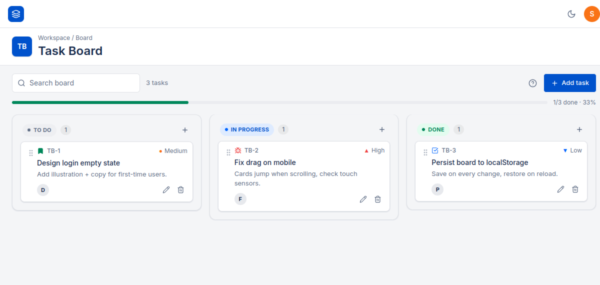
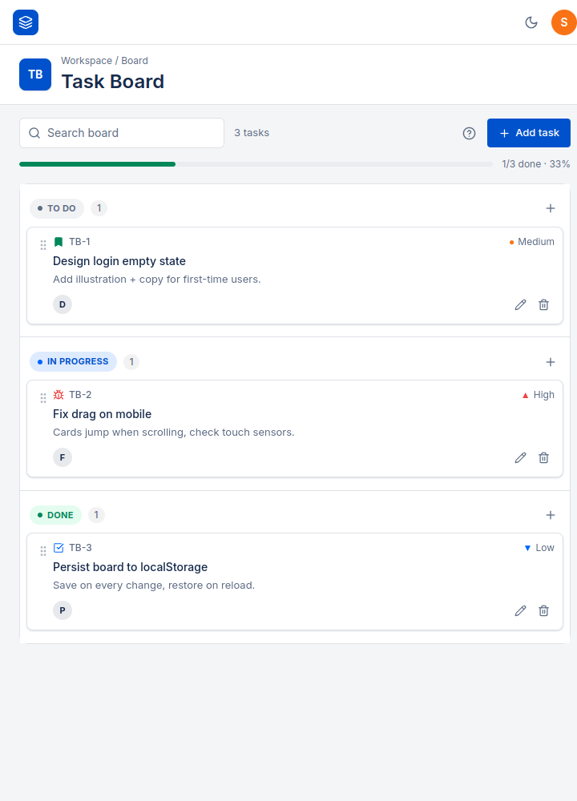

# Task Board

A lightweight task board for organizing work across **To Do**, **In Progress**, and **Done**. Create and update tasks, move them between columns, and keep board data in your browser.

[Open the live app](https://sabareesh-works.github.io/assignment-Realiti.io/)

## Screenshots

### Desktop



### Narrow layout



## Features

- Create tasks with a title, description, type (Task, Story, or Bug), and priority (Low, Medium, or High).
- Drag task cards between status columns. Edit a task's status from its form or detail page as well.
- Search task titles, descriptions, and IDs; see the completed-task count and progress at a glance.
- Open a task's detail page to edit its description and status, or manage attachments.
- Attach up to five files per task, up to 1.5 MB each. Image attachments can be previewed and files can be downloaded from the detail page.
- Switch between light and dark themes, and replay the first-visit board guide.
- Start with sample tasks on a new browser; add, edit, and delete tasks from the board.

## Requirements

- Node.js 20 or later
- npm

## Run locally

```bash
npm ci
npm run dev
```

Open [http://localhost:3000](http://localhost:3000).

Create a production static export with:

```bash
npm run build
```

The exported site is written to `out/`.

## Data storage

Tasks, attachments, and the selected theme are saved in the browser's `localStorage`. Data is specific to the browser profile on that device; it is not sent to a server or synchronized between users. Clearing site data removes the saved board.

## Project structure

```text
app/
	layout.js             Shared page layout, metadata, header, and footer
	page.js               Board page (`/`)
	task/page.js          Task detail page (`/task?id=TB-1`)
	globals.css           Tailwind layers and global styles
components/
	Board.js              Board state, search, progress, and drag-and-drop
	Column.js             Status column and its task list
	TaskCard.js           Task card actions and navigation
	TaskModal.js          Create and edit form
	ConfirmDialog.js      Delete confirmation
	Header.js             App header and project identity
	Footer.js             App footer
	ThemeToggle.js        Light/dark theme control
	Tour.js               First-visit guide
lib/
	store.js              Status definitions, sample tasks, and localStorage helpers
docs/screenshots/       README screenshots
.github/workflows/
	deploy.yml            GitHub Pages build and deployment
next.config.mjs         Static export and GitHub Pages base path
```

## Deployment

The GitHub Actions workflow in `.github/workflows/deploy.yml` builds and deploys the static export to GitHub Pages when changes are pushed to `main`. It can also be started manually with `workflow_dispatch`. The production base path in `next.config.mjs` matches this repository's Pages URL.

## Tech stack

Next.js 14 App Router, React 18, Tailwind CSS, `@hello-pangea/dnd`, and `lucide-react`.
